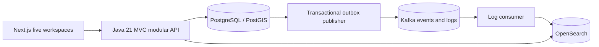
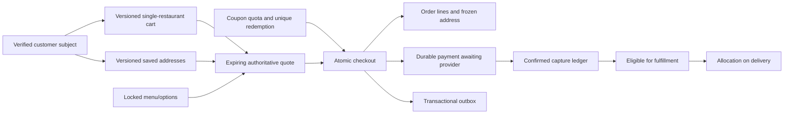

# Architecture and decisions

## ADR 001 — one backend boundary

A modular monolith keeps order snapshots, quotes, financial operations and outbox records transactional in PostgreSQL. Payment HTTP mutations run outside transactions through durable worker operations, stable keys and reconciliation; provider capture is no longer part of checkout commit. Consolidation avoids a cross-service checkout saga while preserving external ambiguity and compensation explicitly. A later hybrid can extract the indexer first. Event sourcing and Redis are not justified by the current implementation.

## ADR 002 — money and state

Integer paise; server reads prices with shared row locks. Customer+idempotency key is unique, with fingerprint item/quantity. An advisory transaction lock serializes customer/idempotency-key operations; concurrent repeated requests return the persisted order. Database constraint conflicts now return 409. Order transitions lock the order row. A partial unique index prevents simultaneous active driver allocations. Refunds and captures have unique order/kind constraints. Financial records are simulation records, not a full double-entry accounting system.

## ADR 003 — events and logs

Outbox rows commit with order state. Publisher locks bounded batches with SKIP LOCKED, awaits Kafka acknowledgment, then marks published. A crash between acknowledgment and commit causes duplicates. Log document IDs use outbox IDs, so replay replaces the same document. Business event consumers/inbox, versioned complete envelopes, schema registry, Kafka retention and dead-letter recovery are not implemented. Kafka acceptance acknowledges a single local broker, not multi-AZ durability. No claims of collector or trace integration.

## AWS six pillars review

| Pillar | Implemented evidence | Risk / required verification |
|---|---|---|
| Operational excellence | build, 45 unit tests, browser acceptance, payment issue/reconciliation history | CI, dashboards, rollback and incidents absent |
| Security | role/resource checks, parameterized SQL, bounded log query | OIDC code+PKCE, server sessions and CSRF added; tenant isolation, deployed TLS, secret rotation and privacy remain incomplete |
| Reliability | DB transactions, outbox, webhook inbox, stable payment keys, reserved refunds, provider reconciliation, locks, unique driver index | one broker/node; consumer retry exhaustion unsafe; no HA or backup test |
| Performance | spatial index, bounded outbox and log queries | no load measurements; business indexes and paging incomplete |
| Cost | consolidated services, no unnecessary Redis, bounded payment requests | frequent payment polling/history retention, search sizing and production cost model unvalidated |
| Sustainability | virtual threads, batched publisher | idle polling and always-on search; no autoscaling |

## Capacity estimates (not benchmarks)

1M daily orders averages 11.57/s; 1000/s peak is 86.4x average. At 500ms latency peak checkout concurrency is ~500. 50k search RPS at 100ms needs ~5000 concurrent requests and a caching/read-replica design absent here. At 20 business log events/order and 1KiB/event: ~20GB/day before infrastructure logs. 1M logs/s at 1KiB is ~1GB/s and ~88TB/day if sustained, so the 1–10TB/day scenario requires low duty cycle or smaller events. At 10TB/day, 30 hot days is 300TB raw; assume 1.5x index expansion and one replica: ~900TB before free-space reserve. At 50GB primary shards this is ~9000 primary shards; workload/retention tiering must reduce the active search set. At 365 days, 10TB/day archival is 3.65PB before compression. Partitions require measured producer/consumer throughput; at a hypothetical 10MB/s/partition, peak ingress requires >100 partitions before headroom. These figures do not certify any target or cost.

## Runbook

If orders stop advancing, inspect API health, outbox unpublished count, Kafka availability and consumer errors. Do not delete outbox rows to unblock failures. On search outage, restore search and explicitly replay Kafka offsets only after verifying retention covers the gap. Default retry exhaustion can lose index updates: production requires a durable dead-letter/replay mechanism before launch. Stop local stack with `docker compose stop`; retain volumes. `down -v` destroys local data and is not a recovery procedure.

## Increment: identity, meals and tracking

See oidc-customization-tracking.md. OIDC replaces all Basic-auth fixtures in the API/UI. Production configuration is fail-closed for insecure issuer/callback/origin URLs and cookies. Durable order tracking uses indexed (order_id, version) events; each node bounds active SSE clients and rechecks database ownership and session existence. Menu groups/options and snapshots share the authoritative marketplace database. Multi-pod stream routing works through database replay, with a per-pod connection limit; global quotas/load are unverified.

## Provider revocation and routing increment

ProviderSessions now supplies a shared JDBC OIDC registry and transactional logout receipts/tombstones. Native Spring back-channel validation gates the handler. Session/API/SSE checks read shared revocation state; no Redis or per-pod logout fan-out is needed for this baseline. Query cost and multi-node failure behavior remain unmeasured. RoadRouter is an OSRM adapter with a bounded bulkhead, timeouts, limited payload schema, short failure backoff and an explicit local-simulator strategy. OrderRoutes authorizes before serving a bounded per-version cache. Leaflet displays real geometry; optional tiles have visible attribution. Routing never runs inside order mutation transactions. See provider-revocation-routing.md for limits and production risks.

## Persistent checkout increment

Checkout creation remains one PostgreSQL transaction; payment now follows asynchronously through durable provider operations and compensation (see the payment increment below). Resource ownership and address revisions protect customer data. PostGIS checks the actual saved destination within 8km, then pricing revalidation prevents stale quotes from charging. Coupon row locks plus database uniqueness bound redemptions. Customer address snapshots are separated from restaurant-facing item snapshots. Cart/access indexes and bounded line counts reduce cost; production load and retention are still unvalidated. See addresses-cart-checkout.md.

## ADR 004 — durable provider payment operations

The modular API now owns durable provider payments/refunds, signed webhook inbox application, reconciliation and issue records (V8). A separate persistent local test provider models asynchronous HTTP/callback failures. Stable operation keys and order-first SQL locks protect monetary effects; fulfillment is gated on confirmed capture. This retains one business deployment boundary while separating external-provider failure from database transactions. See [payment contract and recovery decisions](payment-sandbox.md). External Stripe test interoperability, payout settlement and production hardening remain unverified/incomplete.

## ADR 005 — support approval and verified reviews

Support, reviews and manual moderation stay inside the modular business API. Approval reserves an existing durable payment refund in the same PostgreSQL transaction as the version-checked support decision and audit record; provider calls stay outside that transaction. Order-first locks and unique order constraints prevent conflicting decisions and duplicate feedback. Review visibility and restaurant aggregates query the same committed published rows, without adding a cache or search deployment. Bounded lists/messages limit work; production pagination, content/privacy controls, metrics and escalation remain unfinished. See [contract and six-pillar review](support-reviews.md).

## ADR 006 — transactional inbox delivery, escalation and review revisions

Durable in-app notification records share the business transaction, with unique source-version/audience keys and per-subject read receipts. This provides a precise database acceptance boundary without an unnecessary notification deployment or an unimplemented external-delivery promise. Deadline escalation scans bounded due rows and reuses order-first locks/version checks, so manual and scheduled workers converge on one transition. Review edits/moderation share one optimistic version and persist revision snapshots; hidden edits never restore publication. No new Redis/cache, broker or paid messaging service was introduced. See [contracts, failure semantics and six-pillar risks](escalation-notifications-review-editing.md).

## ADR 007 — durable opt-in channel delivery and explicit uncertainty

V11 fan-out snapshots per-subject consent into PostgreSQL channel jobs in the inbox transaction. A separate worker executor leases/fences bounded batches and keeps provider calls outside business transactions. Native SMTP, Twilio and encrypted Web Push adapters use verified destinations or constrained browser endpoints. An independent persistent local provider makes all channels runnable without paid accounts; it is selected explicitly and never substitutes success after a native failure. Unknown non-idempotent sends stop rather than blindly repeat. Read-only receipt reconciliation and consent invalidation preserve accurate outcomes. Known SMTP acceptance is distinct from delivery. See [contracts, tests and six-pillar risks](notification-channels.md).
