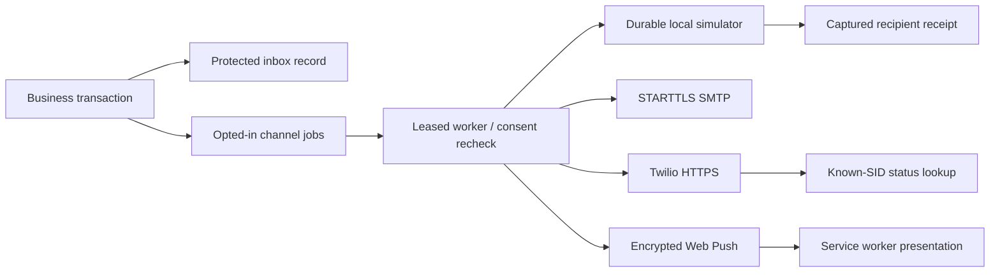

# Email, SMS and browser push notification channels

This increment adds opt-in delivery channels alongside the durable in-app inbox. All three workflows run locally without paid accounts or real recipients. SMTP, Twilio and encrypted Web Push adapters are implemented; **external SMTP/Twilio/push-provider delivery has not been verified**. Local capture, actual browser notification presentation through the service worker, fault recovery and permission-denied fallback are separately verified in the report. The real SMTP adapter also passed an authenticated TLS 1.3 send to an isolated loopback STARTTLS fixture. Native browser push registration was attempted with ephemeral VAPID keys but timed out; remote push delivery is not verified.

## Local demonstration

From the project root:

```sh
docker compose up -d
mvn -f backend/pom.xml verify
java -jar backend/target/marketplace-0.1.0.jar --spring.profiles.active=local
# Separate terminal
cd frontend
npm ci
npm run build
./node_modules/.bin/next start -H 127.0.0.1 -p 3008
# Separate terminal, project root; run sequentially
node tests/notification-channels.cjs
python3 tests/notification-channel-durability.py
```

Sign in and open `/notifications`. Enable email/SMS with a local `.test` or `.invalid` email and a `+1555` fixture phone number (for example `+15551234567`), save, then select Enable browser push. Consent is off by default. A new order/payment/support/review event creates channel jobs only for enabled destinations. Delivery history shows state, masked destination, attempts, provider error category and optional browser presentation. View simulated message opens captured email/SMS content without sending it to a real recipient. Opting out cancels queued/unsent retry jobs and prevents future fan-out; an already in-flight or provider-accepted send cannot be recalled.

The independent Python simulator listens on loopback port 8608 and persists captures/idempotency records in SQLite WAL on the `channel-provider` volume. Its bearer API and control tokens are local fixtures, configurable with `LOCAL_CHANNEL_API_KEY` and `LOCAL_CHANNEL_CONTROL_TOKEN`. The source is mounted read-only in Compose. It performs no outbound email, phone or push send. Local simulation is rejected unless the backend explicitly permits insecure local mode, uses a loopback URL and has a fixture key. Production defaults disable all external channels; there is no automatic success-producing fallback after a real-provider failure.

## Configured providers

| Channel | Mode/environment | Behavior and prerequisites |
|---|---|---|
| Email | `EMAIL_MODE=smtp`; `MAIL_HOST`, `MAIL_PORT` (587 default), `MAIL_USERNAME`, `MAIL_PASSWORD`, `MAIL_FROM` | Jakarta Mail via Spring Mail. Authentication, required STARTTLS, hostname verification and bounded connection/read/write timeouts. Recipient must match the signed OIDC `email` with `email_verified=true`. Stable Message-ID aids operator reconciliation but does not guarantee SMTP deduplication. |
| SMS | `SMS_MODE=twilio`; `TWILIO_ACCOUNT_SID`, `TWILIO_AUTH_TOKEN`, `TWILIO_FROM` | Fixed HTTPS Twilio Messages API, no redirects. E.164 destination must match signed OIDC `phone_number` with `phone_number_verified=true`. Known message SIDs are polled for actual status; queued/sent is not delivery confirmation. |
| Push | `PUSH_MODE=webpush`; `VAPID_PUBLIC_KEY`, `VAPID_PRIVATE_KEY`, `VAPID_SUBJECT` | Browser-generated PushSubscription after a user gesture and permission. VAPID authentication and AES128GCM payload encryption use web-push 5.1.2 with Bouncy Castle 1.86 and jose4j 0.9.7. Key material stays on the backend except the public application-server key. HTTPS application origin is required outside local development. |

Each mode can independently be `local` or `disabled`; otherwise its native provider name above is required. Keep credentials in environment/secrets management, never browser code or source control. Native adapters fail startup when required configuration is missing. Configuration examples describe available code, not externally validated account interoperability.

Identity-provider contact verification is required for real email/SMS. Configure the provider to release the relevant verified email/phone claims; when required, override the Spring OIDC registration scope (for example `SPRING_SECURITY_OAUTH2_CLIENT_REGISTRATION_KEYCLOAK_SCOPE=openid,profile,email,phone`) and configure those scopes with the provider. The local realm and an arbitrary provider profile do not guarantee a verified phone claim. Email matching is exact, including the local part, to avoid authorizing a distinct case-sensitive mailbox. The browser cannot assert verification or supply another unverified recipient. This increment deliberately does not introduce a production OTP issuer. There is one enabled push registration per subject in this baseline; the same enabled endpoint cannot be registered by two subjects. Operators' shared-audience alerts remain in-app: external fan-out is limited to explicit SUBJECT notifications, avoiding a persisted administrator audience list that could outlive role revocation.

Push subscriptions are restricted to HTTPS on the known Google, Mozilla and Apple push-service hosts, port 443/default, with no userinfo, query or fragment; private/loopback/arbitrary endpoints are rejected. P-256 key/auth lengths and public-key parsing are validated. Native HTTP calls have a request deadline, response-size bound and no redirects. The library prepares encryption/VAPID; the application's bounded JDK HTTP client performs network transport.

The service worker caches no private data. Its native push handler validates message identifiers/routes, shows a generic lock-screen message and opens only approved same-origin paths. Actual native delivery depends on the browser push service, OS permissions, device state and platform support (including iOS/PWA requirements); those remote/platform paths remain unverified here.

## Local push versus native push

Local push has its own random browser registration and authenticated polling bridge while the application is open. Simulator acceptance is independent of that bridge. When permission is granted, the bridge hands the update to the real service worker and `showNotification`; the acceptance suite inspects `getNotifications()` and the authenticated presentation acknowledgment. When Chrome permission is denied, the bridge shows an explicit **Simulated push** in-app update instead. It never labels that fallback as an OS popup.

This simulator is not an offline/background push network. Native Web Push uses `PushManager.subscribe`, encrypted provider delivery and the service-worker `push` event, and can work while the page is closed when the browser/platform permits it. Successful local presentation does not certify remote background delivery or a human read. Push content remains generic to protect shared-device lock screens; order/support/private text is retrieved only through resource-authorized application APIs.

## Durable job and delivery semantics

V11 adds recipient-owned settings and `notification_deliveries`. A source notification and one delivery job per enabled channel commit in the same PostgreSQL transaction. Jobs snapshot recipient, mode, subscription and preference version. Changing settings invalidates unsent work. The inbox remains available independently of channel failures, and enabling a channel does not replay historical notifications.



The delivery worker runs on its own executor, so blocking provider work does not block the payment/escalation scheduler. Batches use `FOR UPDATE SKIP LOCKED`, five-minute leases and claim tokens; stale results cannot overwrite a later claim. HTTP futures are cancelled on deadline and SMTP has transport timeouts. This baseline has one channel worker thread per process, not a measured high-throughput system.

States are QUEUED, SENDING, RETRY, ACCEPTED, DELIVERED, FAILED, UNKNOWN or CANCELLED. Interpret them by provider:

- Local DELIVERED means captured in the independent simulator mailbox/device queue. Browser presentation is recorded separately.
- SMTP ACCEPTED means the transport returned successfully; inbox placement, bounce handling and reading are not known. It remains ACCEPTED without pretending to have a recipient receipt.
- Twilio ACCEPTED means queued/in progress; only the documented successful terminal provider status becomes DELIVERED. Failed/undelivered states remain failures.
- Web Push ACCEPTED means push-service acceptance, not OS/human delivery. An authenticated browser presentation acknowledgment can mark DELIVERED. Such acknowledgments are presentation telemetry, not payment/security proof.

Local sends reuse the delivery UUID as their provider idempotency key. A response lost after provider commit retries the same operation and returns the original receipt. At most five local send attempts use bounded exponential backoff; unresolved exhaustion becomes UNKNOWN. A definitive 429 can be retried for native HTTP channels. Uncertain real SMTP/SMS/push sends or expired in-flight leases become UNKNOWN and **are not blindly resent**: SMTP and Twilio creation do not provide the simulator's idempotency guarantee. Known receipt IDs are reconciled by read-only polling, including after opt-out; unresolved local/SMS receipt polling expires after three days. Known SMTP/native-push acceptance is not incorrectly aged by that polling policy.

Permanent rejection remains FAILED. Push expiry (404/410) disables the matching subscription version, preserving a newer replacement. Preferences are rechecked before dispatch; consent changes cannot recall a request already in flight. Local provider parameter conflicts become uncertain rather than falsely claiming delivery. Preserve application origin and original provider configuration while retrying/reconciling; changes can alter a simulator request fingerprint. A fully audited operator repair/replay workflow is not implemented.

## Native protocol fixture (optional separate test)

The checked-in fixtures verify real SMTP protocol behavior without external mail. Stop the ordinary backend before starting this configuration, and use a fresh private directory:

```sh
python3 tests/prepare-native-notification-fixture.py
# Separate terminal: loopback server, no outbound mail
python3 tests/starttls-smtp-fixture.py --directory /tmp/saffron-native-notification-fixture
# Separate terminal, project root; use Java 21
( set -a
  . /tmp/saffron-native-notification-fixture/config.env
  set +a
  java -Xmx512m \
    -Djavax.net.ssl.trustStore=/tmp/saffron-native-notification-fixture/truststore \
    -Djavax.net.ssl.trustStorePassword=changeit \
    -jar backend/target/marketplace-0.1.0.jar --spring.profiles.active=local
)
# Separate terminal, frontend still running
node tests/native-notification-adapters.cjs
```

The preparer generates a two-day localhost certificate and ephemeral VAPID pair in a 0700 directory with a 0600 private environment file. It copies the Java trust store and adds the fixture certificate **only to that copy**; system trust is unchanged. `changeit` is the copied Java test trust-store password, not a production credential. The loopback server records only local fixture mail. The test requires the imported customer's verified `.invalid` email, rejects an unverified recipient, triggers a business notification, validates TLS/authentication/Message-ID and asserts SMTP ACCEPTED rather than recipient delivery. It also attempts native PushManager registration; UNAVAILABLE is explicitly reported and is not a passed remote-push delivery check. One intermediate SMTP attempt was rejected by the initial fixture's incomplete SASL authorization-ID handling; the fixture was corrected and the positive path then passed.

Stop the fixture/native backend afterward, restore the ordinary local profile without the temporary environment, and remove the generated directory (including keys/captured mail). The completed verification restored the normal local demo and removed that temporary material. No external SMTP recipient, Twilio account send or paid transaction was used.

## Protected APIs

| Method | Path | Behavior |
|---|---|---|
| GET | `/api/notification-channels` | Own preferences/modes, masked summaries, own email/SMS edit values and verified contact claims; no push secrets |
| POST | `/api/notification-channels/{EMAIL\|SMS\|PUSH}` | Own `{version,enabled,destination,p256dh?,auth?}`; CSRF and optimistic version; native contact verification |
| GET | `/api/notification-channels/deliveries` | Latest 100 own jobs, masked destinations and status; administrators do not inherit private recipient access |
| GET | `/api/notification-channels/deliveries/{id}/local-message` | Own local capture only; stripped destination metadata |
| GET | `/api/notification-channels/local-push?device=…` | Own matching local device, enabled/current registration only |
| POST | `/api/notification-channels/deliveries/{id}/displayed` | Own push-job presentation acknowledgment |

No channel API bypasses the existing session/CSRF controls. The simulator API and fault controls require separate bearer credentials and are not forwarded to the browser. No new payment webhook exception is added. Provider credentials, endpoint auth material, destinations and exception bodies are not logged; failure messages are deliberately generic. Stored recipient/subscription data still require production database encryption, retention/deletion and controlled backups.

## Verification and remaining risks

Run the new suite and existing notification/payment/identity regressions sequentially. `notification-channel-durability.py` restarts only the local simulator and compares a prior captured receipt, then uses an isolated/removed clock-aging database fixture. It is a local test, not a production maintenance command.

Native-adapter unit evidence includes VAPID signature verification/encrypted payload preparation with current cryptography, SSRF/header-injection prevention, verified-claim gates and an actual loopback SMTP protocol test that refuses authentication/delivery when STARTTLS is absent. This is not a successful native SMTP/phone/push-service account test. See [verification.md](verification.md) for exact executed results.

Remaining work includes live provider interoperability, bounce/webhook authentication and status reconciliation beyond current polling, receipt retry/UI operator recovery, multi-device management, contact-change/reverification policies, per-event preferences, quiet hours, unsubscribe endpoints, comprehensive rate/spend limits, retention/export/erasure, notification metrics/alerts, multi-pod/crash/outage certification and provider SLO/load testing. Opt-in SMS currently covers all emitted subject updates; segmentation and message volume can be costly with a real account and are not cost-certified. No paid send or production readiness is claimed.

## Six-pillar review

| Pillar | Implemented choice | Risk / next validation |
|---|---|---|
| Operational excellence | Durable job history, generic errors, retry/receipt states, provider simulator and reproducible fault checks | Missing delivery SLO dashboards, alerting and audited uncertain-send repair |
| Security | Verified OIDC contacts, opt-in, CSRF/ownership, STARTTLS, VAPID encryption, endpoint constraints and generic lock-screen content | Contact-change lifecycle, storage encryption, retention/privacy and complete provider security review |
| Reliability | Atomic fan-out, stable local keys, leases/fencing, consent recheck, conservative unknown outcomes and independent persistent simulator | Real channels have no blanket exactly-once guarantee; no multi-pod/outage certification |
| Performance | Bounded worker batches, HTTP/body/time limits, indexed due/owner queries | Single worker, one browser per account, non-paged delivery history; load unmeasured |
| Cost | Local defaults, no paid accounts required, opt-in and bounded retry | Real SMS volume/segmentation, SMTP/provider quotas and billing controls unvalidated |
| Sustainability | Reuses modular API and existing database; one lightweight local simulator | Polling, per-message SMTP connections and data lifecycle need optimization |

Official contracts consulted: [Spring email support](https://docs.spring.io/spring-boot/reference/io/email.html), [Twilio Message resource](https://www.twilio.com/docs/messaging/api/message-resource), [Web Push library](https://github.com/web-push-libs/webpush-java), [Bouncy Castle release](https://www.bouncycastle.org/resources/new-release-bouncy-castle-java-1-86/), [browser subscription API](https://developer.mozilla.org/en-US/docs/Web/API/PushManager/subscribe). These support implementation decisions, not external-delivery verification.
