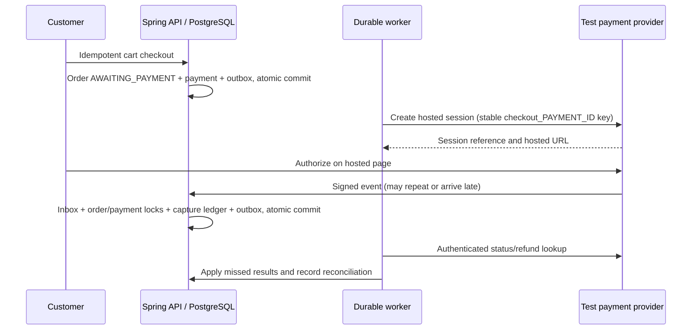

# Payment sandbox, webhooks, refunds and reconciliation

This increment adds provider-backed test payments to the persistent cart checkout. The default local provider runs independently, with its own SQLite WAL database, durable idempotency records and callback queue. A Stripe test-mode HTTP adapter is implemented, but no Stripe account credentials were available for this verification. External Stripe-hosted payment, account eligibility, regional payment-method support and webhook delivery have **not** been verified. Live keys are deliberately rejected. No real money moves.

## Run and demonstrate

From the project root, with Java 21, Maven, Docker, Node and Chrome:

```sh
docker compose up -d
mvn -f backend/pom.xml verify
java -jar backend/target/marketplace-0.1.0.jar --spring.profiles.active=local
# Separate terminal
cd frontend
npm ci
npm run dev
# Separate terminal, project root; run suites sequentially (shared local fixtures)
node tests/payments-sandbox.cjs
node tests/cart-address-checkout.cjs
node tests/oidc-workflows.cjs
```

The local-only fixture users have password `local-demo`. Customer: menu → customize → cart → quote → place order → tracking → **Pay in sandbox** → independent hosted test page → Pay successfully. Redirect parameters never confirm a payment. The server accepts a verified callback or authenticated provider lookup. A paid order then proceeds through restaurant acceptance, preparation, pickup and delivery. In the administrator workspace select **Payments**, enter a delivered/cancelled order, an amount in rupees and a reason to request a refund. **Reconcile now** schedules provider comparisons; it does not fabricate a match.

Port 8508 exposes the simulator on loopback only. Its bearer API key, webhook secret and separate operator-control token are explicit local fixtures, configured through `LOCAL_PAYMENT_API_KEY`, `LOCAL_PAYMENT_WEBHOOK_SECRET`, `LOCAL_PAYMENT_CONTROL_TOKEN`. Match API/webhook values in the backend environment. Do not deploy this simulator, controls, imported IAM realm or development Compose topology to production. `/checkout/{id}` uses a random capability token, collects no PAN/CVV and keeps provider API credentials out of the browser. The SQLite `payment-provider` volume preserves provider state independently of PostgreSQL.

## External Stripe test mode

Set `STRIPE_SECRET_KEY` (`sk_test_…`) and `STRIPE_WEBHOOK_SECRET` through your environment/secrets manager, then start with `--spring.profiles.active=stripe-test` and the ordinary secure OIDC/database/application configuration. For a local-only IAM demo, `--spring.profiles.active=local,stripe-test` selects local IAM plus Stripe test payments. Configure a provider webhook or trusted development forwarder to `POST /api/payments/webhooks/stripe` on the backend (8088 locally). Its signing secret must match that endpoint/forwarder; an API key is not a signing secret. Comma-separated webhook secrets support rotation. Each must be at least 32 characters. Do not commit credentials or pass them as CLI arguments.

Subscribe to `checkout.session.completed`, `checkout.session.async_payment_succeeded`, `checkout.session.async_payment_failed`, `checkout.session.expired`, `refund.created`, `refund.updated`, `refund.failed`. API version is pinned to `2026-10-28.endive`; the configured endpoint must emit a compatible object schema. The adapter currently requests card Checkout sessions in INR, not UPI/wallet/netbanking/COD. Provider onboarding, supported currencies, tax, payout and regional compliance remain operator responsibilities. One provider configuration is active at a time; workers filter by stored provider, and manual refunds reject a payment belonging to another provider. Keep the matching configuration available to reconcile its historical operations.

The adapter uses fixed `https://api.stripe.com`, no redirects, bounded response size (1 MiB), a two-second request deadline and an eight-call bulkhead. Checkout links are restricted to `https://checkout.stripe.com` in Stripe mode or the exact configured loopback simulator host/port. Money is integer paise and comes from the immutable server quote. Client-supplied totals, payment status and success redirects are never payment proof.

Reference contracts: [Checkout creation](https://docs.stripe.com/api/checkout/sessions/create), [idempotent requests](https://docs.stripe.com/api/idempotent_requests), [webhook signatures and delivery](https://docs.stripe.com/webhooks), [refund creation](https://docs.stripe.com/api/refunds/create). These informed implementation; external-provider interoperability still needs an actual account-level test.

## Transaction and recovery design



V8 adds payments, refunds, a hashed webhook inbox, issues and reconciliation history. Existing migration history and business records are retained. Current checkout creates `AWAITING_PAYMENT` / `PENDING`; only a matching paid, complete session records `PAYMENT_CAPTURE` and moves the order to `PLACED`. Restaurant queues hide unpaid orders, and all non-cancellation fulfillment transitions require captured money and no open payment issues. Financial and fulfillment state remain separate.

The consistent database lock order is order → payment → refund. PostgreSQL row locks and unique constraints serialize callbacks, refund reservations, fulfillment and cancellation. Ledger `(order_id,kind)` uniqueness protects monetary effects; event receipt and application commit in the same transaction. Provider mutations happen outside database transactions. A worker claims batches of five using `FOR UPDATE SKIP LOCKED` and 60-second leases. Expired leases support crash recovery; duplicate external requests reuse the original operation identity.

Session creation uses `checkout_PAYMENT_ID`; refund creation uses `refund_REFUND_ID`. Retries never create a fresh key to conceal an ambiguous outcome. Unknown mutations retry with bounded exponential backoff, up to eight attempts and only within 20 hours of creation. This stays below Stripe's documented minimum 24-hour idempotency retention. After the attempt/time horizon an unresolved operation requires review; known references continue status polling. There is no automatic reset/new payment after exhaustion. The worker currently polls due known sessions approximately every 15 seconds in small batches; this is a local correctness baseline, not a scalable scheduler/SLO claim.

Verified session matching includes test mode, session reference, payment metadata, order reference, amount and currency; intent references cannot change after binding. Mismatches are quarantined and block fulfillment. A quarantined lookup is never reported as balanced just because its amount matches. Old unpaid/expired events cannot undo a recorded capture. `complete` but `unpaid` remains unpaid, including asynchronous processing; only an open session is expired on cancellation.

Cancellation requests expiration or compensation without claiming returned money prematurely. A late capture after cancellation remains recorded, leaves fulfillment cancelled and queues a full refund of unreserved captured money. Restaurant rejection uses the same cancellation path. A provider-confirmed failed automatic refund requires operator review and a separately authorized replacement; no fresh automatic refund key is generated indefinitely.

## Webhook security and semantics

Only the exact webhook POST is unauthenticated/CSRF-exempt. Every other payment mutation requires a verified OIDC session, resource authorization and CSRF. The webhook requires HMAC-SHA256 over the original timestamp and raw bytes, constant-time digest comparison, a five-minute timestamp window, and one of the configured secrets. Rotation supports multiple v1 signatures. Payloads are bounded at 64 KiB, signature headers at 4096 characters. Live events, malformed JSON and invalid signatures are rejected. No raw event bodies, bearer credentials or card details are persisted in the inbox.

`(provider,event_id)` is unique; identical content returns a harmless duplicate acknowledgment, changed content under the same ID returns 409. Database errors roll back receipt so a provider retry can recover. Unsupported types/unknown metadata are durably marked ignored. Validly signed but inconsistent known objects are acknowledged as quarantined, retained as issues and never treated as confirmed money. Inbox acknowledgments mean the database transaction committed, not that an unrecognized event changed fulfillment.

## Refund and reconciliation contract

Administrative refunds are allowed only for a cancelled or delivered order, with a positive integer amount, bounded reason and `Idempotency-Key`. Reusing the same key with changed parameters returns 409. Reserved capacity is the sum of all non-failed refund operations, so concurrent requests and pending/unknown provider responses cannot overbook the capture. Only provider-confirmed success increases `refunded_amount` or creates `PAYMENT_REFUND:REFUND_ID`. Failed refunds release their reservation; a replacement needs a new explicit authorization/key. Partial and full results are visible in the customer tracking panel.

Delivered orders already allocate food, demo tax and delivery amounts. Refund reversals use an explicit demo waterfall: food first, then tax, then delivery. This is monotone and exact in paise, with separate reversal entries per refund. It is **not** legal invoice/tax adjustment or a complete double-entry settlement system. Capture/refund totals and net allocations are checked in the local acceptance suite.

Reconciliation obtains the canonical session and refund list, applies missed transitions through the same locked handlers, then compares provider capture/successful refund totals with local money. Each comparison is durable `MATCH` or `MISMATCH`; discrepancies open deduplicated issues. Canonical matching snapshots can resolve amount/balance issues. Unknown provider refunds are flagged instead of guessed/imported. Refund listing is capped at 100; `has_more` is treated as incomplete and a mismatch, never a false match. This is payment-operation reconciliation, not bank/payout/restaurant settlement reconciliation.

| Method | Path | Authorization / result |
|---|---|---|
| GET | `/api/orders/{id}/payment` | Owning CUSTOMER or ADMIN; states, hosted link, confirmed money and refund history |
| POST | `/api/orders/{id}/payment/retry` | Owning CUSTOMER; schedules original operation, no new charge/key |
| POST | `/api/orders/{id}/refunds` | ADMIN + CSRF + Idempotency-Key; `{amount: paise, reason}`; durable request |
| GET | `/api/admin/payments` | ADMIN; latest 100 payments |
| GET | `/api/admin/payments/issues` | ADMIN; latest 100 issues |
| GET | `/api/admin/payments/reconciliations` | ADMIN; latest 100 provider checks |
| POST | `/api/admin/payments/reconcile` | ADMIN + CSRF; audit and schedule |
| POST | `/api/payments/webhooks/stripe` | Provider HMAC; database inbox/application acknowledgment |

## Operations and remaining risks

Start investigation from the admin Payments tab, then inspect the payment/refund IDs, issue code, provider reference, canonical provider object and recent reconciliation. An UNKNOWN result means unresolved, not declined. Restore connectivity and schedule reconciliation; never manually mark a timeout refunded/paid or replace its idempotency key. For exhausted unknown mutations, confirm the provider's actual result and retention before authorizing any recovery; an audited operator repair workflow is still missing. Protect production webhook ingress with TLS, request limits and provider-compatible rate control; edge rate limiting, dedicated payment metrics/alerts, exhaustive audit coverage and multi-pod failure certification remain work.

The sandbox queue retries callbacks a bounded ten times; application status polling demonstrates recovery after missing delivery. Production queue/DLQ operations, raw-event retention policy, long-term reconciliation-history retention, complete accounting, payouts, disputes, chargebacks, external-dashboard refund import, provider object pagination, and live Stripe verification remain unfinished. Coupon reservations still occur at checkout and are not automatically restored on failed/cancelled payment. The local legacy single-item `/api/checkout` stays a compatibility-only instant simulator; the current cart/UI uses the provider path. Full master requirements and production readiness are not claimed.

Verification evidence and exact executed checks are in [verification.md](verification.md) and `results/payments-sandbox.json`. No benchmark or target availability result is inferred from these tests.
