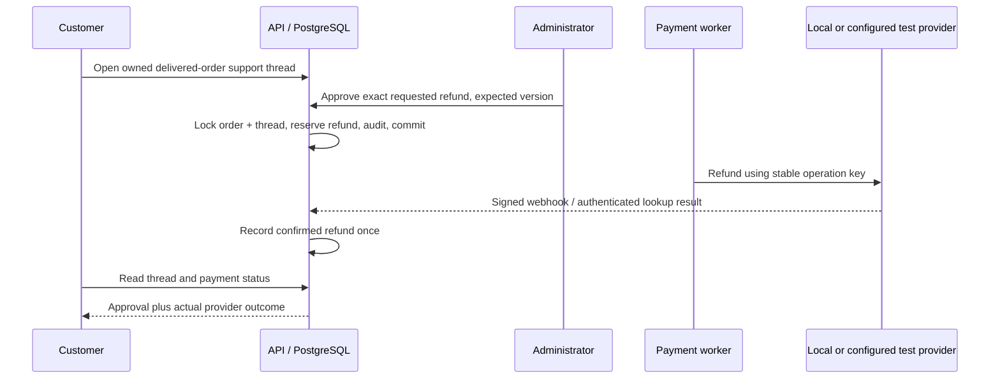

# Order support, refund approval and verified reviews

Escalation, in-app notifications and versioned review editing are now implemented in the [next increment](escalation-notifications-review-editing.md). The immutable-review and missing-escalation/notification statements below describe the original V9 increment and are superseded by V10.

This increment connects customer after-order care to the existing durable payment subsystem. It adds working customer and administrator interfaces, PostgreSQL persistence and resource authorization. It does not complete the entire customer-support or enterprise master specification.

## Customer and administrator workflows

A customer opens `/orders/{id}` after delivery or cancellation and reports missing, damaged, incorrect items or another issue. A refund request is an integer paise amount, bounded by the immutable order total; zero means a non-monetary issue. `/support` lists only that customer's threads, messages and linked provider refund status. Customers can add replies to open threads. The list and selected conversation refresh every four seconds while open.

Administrators open `/support` or the Support tab, reply, resolve without refund, or approve the exact requested amount with an explanation. Approval creates a durable refund operation through `PaymentOperations`; it never manufactures a successful refund or calls the provider while holding database locks. The thread becomes REFUND_APPROVED, with financial status shown separately as REQUESTED/PENDING/UNKNOWN/SUCCEEDED/FAILED. Confirmed returned money remains visible in the order's payment panel. Provider processing and reconciliation follow the [payment contract](payment-sandbox.md).

A customer can rate a delivered order from 1–5 and write a review. One immutable review is permitted per delivered order; repeating the same content returns the existing review, while a different second submission is rejected. Restaurant cards show the average and count of published verified-order reviews. Opening a menu shows its published review text. Public review responses exclude customer subjects, order identifiers, payment information and moderation reasons. Authentication is still required for discovery and review reading.

Administrators use Reviews to hide or restore a review with an explanation and expected version. Hidden reviews immediately disappear from restaurant review responses and aggregate ratings. The author can still inspect the state of their own review. Both generic audit records and a restricted moderation-reason record are retained. Customers, restaurants and drivers cannot moderate reviews or inspect private support operations.

## Persistence, transactions and authorization

V9 adds `support_tickets`, `support_messages`, `order_reviews` and `review_moderation`, retaining existing orders, payment records and migrations. Indexes support owned ticket lists, bounded queues, thread reads and published restaurant reviews.

Ticket creation locks the owned order and stores a canonical request fingerprint under `(customer_subject,idempotency_key)`. Unique order and review constraints prevent multiple threads/reviews for the same order, including concurrent submissions. A changed request under the same key returns 409. No customer or staff identity is taken from request bodies.

Mutation lock order is order → ticket → payment/refund, preserving the payment subsystem's order-first discipline. Reply and decision APIs require an expected thread version. A concurrent staff decision can commit once; stale decisions return 409 before requesting money. Approval, refund reservation, explanatory message, thread state/version and audit records share one database transaction. If payment authorization, captured capacity or provider configuration makes a refund ineligible, the whole decision rolls back. Manual monetary validation remains server-authoritative, including pending refund reservations.

All unsafe browser requests require OIDC sessions and the existing CSRF header/token. Another customer's order/thread/review lookup returns 404; unauthorized roles return 403. Support access is CUSTOMER-owned or ADMIN; restaurant ownership and driver assignment grant no support access. Text is stored as plain text and rendered through React text nodes, with no HTML injection. Control characters other than newline/tab are rejected. Reviews allow 2000 characters, messages 3000 and moderation reasons 500. Support replies stop at 199 messages to reserve room for a final administrator decision, so the bounded thread read (200 messages) does not silently omit the final outcome.

## API contract

| Method | Path | Access / behavior |
|---|---|---|
| POST | `/api/orders/{id}/support` | Owning CUSTOMER; `Idempotency-Key`; `{category,message,requestedRefund}` |
| GET | `/api/support` | CUSTOMER's own threads or ADMIN queue, latest 100 |
| GET | `/api/support/{id}` | Owned or ADMIN; messages and actual linked refund state |
| POST | `/api/support/{id}/messages` | Owned or ADMIN, OPEN only; `{version,message}` |
| POST | `/api/support/{id}/decision` | ADMIN; `{version,decision: REFUND or RESOLVE,message}` |
| POST | `/api/orders/{id}/review` | Owning CUSTOMER, DELIVERED only; `{rating,body}` |
| GET | `/api/orders/{id}/review` | Owning CUSTOMER; own review including moderation state |
| GET | `/api/restaurants/{id}/reviews` | Authenticated; latest 50 PUBLISHED reviews without author/order identity |
| GET | `/api/admin/reviews` | ADMIN; latest 100 reviews and moderation versions |
| POST | `/api/admin/reviews/{id}/moderation` | ADMIN; `{version,hidden,reason}` |

Validation is performed on the backend even when UI controls constrain input. Refund amounts in API bodies are paise; the UI converts decimal rupees without floating-point multiplication. Repeating an approved decision with a stale version is rejected rather than approving another refund. Review summaries are computed from the same committed rows as public review visibility; no eventually consistent rating cache was introduced.

## Run and verify

Use the ordinary [local setup](../README.md): `docker compose up -d`, Java 21 `mvn -f backend/pom.xml verify`, start the local backend, then `cd frontend && npm ci && npm run dev`. In a separate terminal from the project root, run `node tests/aftercare.cjs` (or `npm run test:aftercare` from frontend). Chrome and the imported local Keycloak fixture realm are required. Run browser suites sequentially because they use dedicated shared demo carts and driver identity.

The suite creates its own payment-backed order and address, pays on the independent hosted sandbox, completes restaurant/driver fulfillment, publishes a review, opens/replies to support, approves and confirms a partial refund, moderates/restores the review and inspects restaurant visibility/ratings. It checks unauthorized access, stale versions, rollback after ineligible refund approval, duplicate submissions, concurrent resolution, literal untrusted review text and a 390-pixel mobile viewport. The newly created saved address is soft-deleted in finally; order/support/review/audit fixtures remain as historical demo evidence. Cumulative counts are not performance measurements.

## Limits and next work

- One thread per order, opened only after delivery/cancellation. No active-order support, reopening, changing the requested amount, attachments, chat, escalation, appeal, SLA routing or external customer-care integration.
- A confirmed failed refund remains visibly failed. An administrator must investigate and explicitly authorize a replacement through Payments; approval does not silently generate fresh keys. A dedicated support replacement/recovery workflow is still missing.
- One immutable review per order; no review editing, delivery-partner ratings, owner responses, automated abuse detection, profanity/PII filtering or notifications. Plain-text escaping prevents HTML execution, not inappropriate user content. Moderation is manual.
- Lists are bounded without cursor pagination or filtering. Large operational queues and restaurant review histories need pagination. Four-second polling is a local baseline, not a scale or latency guarantee.
- No new support/review Kafka contracts or notifications; audit records remain in PostgreSQL. Dedicated metrics, alerts, retention/deletion/export, evidence preservation, privacy policies and operator repair remain unfinished.
- Refunds use the existing local/test-provider semantics and demo allocation policy. Live Stripe interoperability, real payouts and legal tax adjustments remain unverified/incomplete.
- No multi-pod, database outage, full accessibility, retention, cloud deployment, throughput or availability certification was performed. Full master requirements remain incomplete, including reorder/invoices and the expanded restaurant, dispatch and observability platforms.

## Six-pillar decision review

| Pillar | Choice and evidence | Remaining risk |
|---|---|---|
| Operational excellence | Durable support/refund links, audited decisions/moderation, unit and browser checks | No support SLA alerts, notification integration or complete incident tooling |
| Security | OIDC/CSRF, owned resources, administrator-only decisions, text escaping, private/public field separation | No content/PII classifier, privacy retention/export or specialist agent roles |
| Reliability | Single DB transaction, order-first locks, versions, unique constraints and existing idempotent provider worker | No multi-pod/outage proof; failed refunds need explicit operator replacement |
| Performance | Indexed bounded lists/messages, published-review index | Rating aggregation/polling and queue pagination need workload validation |
| Cost | Reuses API/database/payment worker; no new service/cache | Polling and retained content/audit growth require cost/retention controls |
| Sustainability | No extra always-on deployment; bounded active-page polling | Event-driven notifications and adaptive polling remain opportunities |
